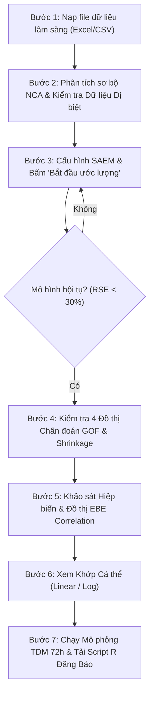

# SÁCH HƯỚNG DẪN KỸ THUẬT VÀ SỔ TAY SỬ DỤNG TOÀN DIỆN
## NỀN TẢNG MÔ HÌNH HÓA DƯỢC ĐỘNG HỌC QUẦN THỂ SimDx (MONOLIXSUITE EDITION)

---

## MỤC LỤC
1. [GIỚI THIỆU TỔNG QUAN VỀ HỆ THỐNG SimDx](#1-giới-thiệu-tổng-quan-về-hệ-thống-simdx)
2. [CƠ SỞ LÝ THUYẾT VÀ NỀN TẢNG TOÁN HỌC](#2-cơ-sở-lý-thuyết-và-nền-tảng-toán-học)
   * 2.1. Mô hình Dược động học Cấu trúc 1-ngăn truyền tĩnh mạch ngắt quãng (Analytical IV Infusion)
   * 2.2. Phân tích Dược động học Độc lập Mô hình (PKanalix Non-Compartmental Analysis - NCA)
   * 2.3. Mô hình Hỗn hợp Phi tuyến (Nonlinear Mixed-Effects Model - NLME)
   * 2.4. Thuật toán Ước lượng Tham số SAEM (Stochastic Approximation Expectation Maximization)
   * 2.5. Ước tính Bayes Thực nghiệm Cá thể (Empirical Bayes Estimates - EBE / MAP)
   * 2.6. Ma trận Thông tin Fisher (FIM), Sai số chuẩn (SE) và Độ co ngót (Shrinkage)
   * 2.7. Thuật toán Monolix Bootstrap 2024 (Non-parametric Resampling)
   * 2.8. Mô hình hóa Hiệp biến và Tìm kiếm Từng bước (Stepwise Covariate Modeling - SCM)
   * 2.9. Tích hợp Hiệp biến Dược lý Di truyền (Pharmacogenomics / Kiểu gen)
3. [HƯỚNG DẪN VẬN HÀNH TỪNG BƯỚC (STEP-BY-STEP WORKFLOW)](#3-hướng-dẫn-vận-hành-từng-bước-step-by-step-workflow)
   * Bước 1: Chuẩn bị và Nạp Dữ liệu Lâm sàng
   * Bước 2: Thiết lập Cấu hình Thuật toán và Chạy SAEM
   * Bước 3: Đánh giá Đạt chuẩn Mô hình (GOF)
   * Bước 4: Sàng lọc Hiệp biến Lâm sàng & Kiểu gen
   * Bước 5: Thẩm định Khớp Đường cong Cá thể (Individual Fits)
   * Bước 6: Mô phỏng Dược lâm sàng TDM & Xuất Báo cáo Nghiên cứu
4. [GIẢI NGHĨA CHI TIẾT TỪNG THÀNH PHẦN NHỎ NHẤT TRÊN GIAO DIỆN](#4-giải-nghĩa-chi-tiết-từng-thành-phần-nhỏ-nhất-trên-giao-diện)
   * 4.1. Khối Thương hiệu và Cấu hình Sidebar
   * 4.2. Tab 1: Dữ liệu Lâm sàng & Phân tích NCA (PKanalix)
   * 4.3. Tab 2: Ước lượng SAEM & Bootstrap Module
   * 4.4. Tab 3: Chẩn đoán Đạt chuẩn Mô hình (Goodness-of-Fit)
   * 4.5. Tab 4: Khảo sát Hiệp biến & Mô hình SCM
   * 4.6. Tab 5: Khớp Dữ liệu Cá thể (Individual Fits)
   * 4.7. Tab 6: Mô phỏng Dược lâm sàng Simulx & Xuất Mã nguồn R
5. [CÂU HỎI THƯỜNG GẶP VÀ XỬ LÝ LỖI (TROUBLESHOOTING)](#5-câu-hỏi-thường-gặp-và-xử-lý-lỗi-troubleshooting)

---

## 1. GIỚI THIỆU TỔNG QUAN VỀ HỆ THỐNG SimDx

**SimDx** là hệ thống phần mềm chuyên dụng phục vụ mô hình hóa Dược động học Quần thể (Population Pharmacokinetics - PopPK) và Tối ưu hóa Chế độ Liều Cá thể hóa (Therapeutic Drug Monitoring - TDM). Được thiết kế theo chuẩn mực cao nhất của bộ phần mềm công nghiệp **Lixoft MonolixSuite** (bao gồm Monolix, PKanalix, Datxplore và Simulx), SimDx giải quyết bài toán cốt lõi: **Định lượng các nguồn biến thiên dược động học giữa các cá thể người bệnh (Inter-Individual Variability - IIV)** và **tác động của các đặc điểm sinh lý/bệnh lý/di truyền (Covariates)** để cá thể hóa chế độ dùng thuốc, đặc biệt là các kháng sinh có khoảng điều trị hẹp như Vancomycin, Aminoglycoside, hoặc thuốc ức chế miễn dịch (Tacrolimus).

SimDx tuân thủ nguyên tắc tính toán giải tích chính xác tuyệt đối (sai số tương đối $< 10^{-13}$ so với ODE vi phân), tốc độ hội tụ siêu nhanh nhờ vector hóa NumPy, và giao diện Streamlit hiện đại chuẩn hóa theo hướng dẫn của FDA/EMA.

---

## 2. CƠ SỞ LÝ THUYẾT VÀ NỀN TẢNG TOÁN HỌC

### 2.1. Mô hình Dược động học Cấu trúc 1-ngăn truyền tĩnh mạch ngắt quãng (Analytical IV Infusion)

Đối với thuốc dùng đường truyền tĩnh mạch ngắn ngắt quãng (Intermittent IV Infusion), nồng độ thuốc trong máu tuân theo phương trình vi phân cân bằng khối lượng:

$$\frac{dC(t)}{dt} = \frac{R(t)}{V} - k_{el} \cdot C(t)$$

Trong đó:
* $R(t)$: Tốc độ truyền tĩnh mạch (Rate of infusion). Nếu truyền liều $D$ trong khoảng thời gian $T_{inf}$, thì $R(t) = \frac{D}{T_{inf}}$ trong suốt thời gian truyền và $R(t) = 0$ khi ngừng truyền.
* $k_{el} = \frac{CL}{V}$: Hằng số tốc độ đào thải ($h^{-1}$).
* $CL$: Độ thanh thải toàn phần của cơ thể ($L/h$).
* $V$: Thể tích phân bố của ngăn trung tâm ($L$).

#### Nghiệm giải tích chính xác (Analytical Exact Solution)
SimDx sử dụng nguyên lý cộng dồn tuyến tính (Superposition Principle) để tính toán chính xác nghiệm của chuỗi $M$ liều truyền bất kỳ mà không cần xấp xỉ bước nhảy Runge-Kutta:

Đối với một liều truyền thứ $j$ bắt đầu tại thời điểm $t_{dose, j}$ với liều $D_j$ và thời gian truyền $T_{inf, j}$, đóng góp nồng độ tại thời điểm quan sát $t \ge t_{dose, j}$ là:

$$C_j(t) = \begin{cases} 
0 & \text{khi } t < t_{dose, j} \\
\displaystyle \frac{D_j}{T_{inf, j} \cdot CL} \left[1 - e^{-k_{el} (t - t_{dose, j})}\right] & \text{khi } t_{dose, j} \le t \le t_{dose, j} + T_{inf, j} \quad \text{(Giai đoạn đang truyền)} \\
\displaystyle \frac{D_j}{T_{inf, j} \cdot CL} \left[1 - e^{-k_{el} T_{inf, j}}\right] e^{-k_{el} (t - t_{dose, j} - T_{inf, j})} & \text{khi } t > t_{dose, j} + T_{inf, j} \quad \text{(Giai đoạn ngừng truyền/thải trừ)}
\end{cases}$$

Tổng nồng độ tại thời điểm $t$ là tổng đóng góp của tất cả các liều đã truyền trước đó:

$$C(t) = \sum_{j: t_{dose, j} \le t} C_j(t)$$

---

### 2.2. Phân tích Dược động học Độc lập Mô hình (PKanalix Non-Compartmental Analysis - NCA)

Trước khi xây dựng mô hình cấu trúc phức tạp, phân tích NCA được thực hiện nhằm mô tả trực tiếp các đặc tính phơi nhiễm của thuốc dựa trên dữ liệu thực nghiệm:

1. **Nồng độ đỉnh $C_{\max}$ và Thời điểm đạt đỉnh $T_{\max}$**:
   $$C_{\max} = \max_k (DV_k), \quad T_{\max} = \text{Time ứng với } C_{\max}$$
2. **Diện tích dưới đường cong nồng độ - thời gian ($AUC_{0-t}$)**:
   Được tính toán theo quy tắc hình thang tuyến tính (Linear Trapezoidal Rule):
   $$AUC_{0-t} = \sum_{k=1}^{n-1} \frac{DV_k + DV_{k+1}}{2} \cdot (t_{k+1} - t_k)$$
3. **Hằng số tốc độ đào thải pha cuối ($k_{el}$ hay $\lambda_z$)**:
   Được xác định bằng hồi quy tuyến tính bình phương tối thiểu giữa $\ln(DV)$ và $t$ trên các điểm thuộc pha đào thải cuối cùng (ít nhất 3 điểm nồng độ cuối):
   $$\ln(DV_k) = \text{intercept} - k_{el} \cdot t_k \implies k_{el} = - \text{slope}$$
4. **Thời gian bán thải pha cuối ($t_{1/2}$)**:
   $$t_{1/2} = \frac{\ln(2)}{k_{el}} \approx \frac{0.693}{k_{el}}$$
5. **Diện tích dưới đường cong ngoại suy đến vô cùng ($AUC_{0-\infty}$)**:
   $$AUC_{0-\infty} = AUC_{0-t} + \frac{DV_{last}}{k_{el}}$$
   *(với $DV_{last}$ là nồng độ quan sát định lượng được cuối cùng)*.
6. **Độ thanh thải biểu kiến ($CL_{NCA}$) và Thể tích phân bố ($V_{d, NCA}$)**:
   $$CL_{NCA} = \frac{\text{Dose}}{AUC_{0-\infty}}, \quad V_{d, NCA} = \frac{CL_{NCA}}{k_{el}}$$

---

### 2.3. Mô hình Hỗn hợp Phi tuyến (Nonlinear Mixed-Effects Model - NLME)

Mô hình NLME phân tách nồng độ quan sát thành 3 tầng cấu trúc:

```
[ Tầng 1: Giá trị trung bình Quần thể ]  ---> θ (Fixed Effects: CL_pop, V_pop)
                    │
[ Tầng 2: Biến thiên giữa các Cá thể ]   ---> η_i ~ N(0, Ω) (Between-Subject Variability)
                    │
[ Tầng 3: Biến thiên Dư / Sai số đo ]    ---> ε_ij ~ N(0, 1) (Residual Unexplained Variability)
```

#### Cấu trúc toán học:
Nồng độ quan sát $y_{ij}$ của cá thể thứ $i$ tại thời điểm thứ $j$ được mô hình hóa bởi:

$$y_{ij} = f(t_{ij}, \psi_i) + g(t_{ij}, \psi_i, \xi) \cdot \varepsilon_{ij}$$

Trong đó:
* $\psi_i$: Vector thông số dược động học cá thể của bệnh nhân $i$ (ví dụ: $[CL_i, V_i]^T$).
* $f(t_{ij}, \psi_i)$: Hàm dự đoán nồng độ của mô hình cấu trúc.
* $\varepsilon_{ij} \sim \mathcal{N}(0, 1)$: Sai số ngẫu nhiên dư chưa giải thích được.
* $g(\cdot)$: Hàm cấu trúc sai số (Residual Error Model).

#### Mô hình phân bố thông số cá thể (Log-Normal Distribution):
Để đảm bảo các thông số sinh lý ($CL, V$) luôn mang giá trị dương, tham số cá thể được giả định phân bố log-chuẩn:

$$\ln(\psi_i) = \ln(\theta) + \beta \cdot c_i + \eta_i \iff \psi_i = \theta \cdot \exp(\beta \cdot c_i) \cdot \exp(\eta_i)$$

* $\theta$: Vector thông số cố định của quần thể (Fixed effects, ví dụ $CL_{pop}, V_{pop}$).
* $c_i$: Vector hiệp biến chuẩn hóa của cá thể $i$.
* $\eta_i \sim \mathcal{N}(0, \Omega)$: Biến cố ngẫu nhiên giữa các cá thể (Inter-Individual Variability - IIV) với ma trận hiệp phương sai $\Omega = \text{diag}(\omega_{CL}^2, \omega_V^2)$.
* Độ biến thiên giữa các cá thể thường được báo cáo dưới dạng Hệ số Biến thiên Phần trăm:
  $$CV\% = \sqrt{\exp(\omega^2) - 1} \times 100\% \approx \omega \times 100\%$$

#### Mô hình Sai số Dư Kết hợp (Combined Proportional and Additive Error):
$$g(t_{ij}, \psi_i, \xi) = \sqrt{a^2 + b^2 \cdot f(t_{ij}, \psi_i)^2}$$
* $a$ (mg/L): Thành phần sai số cộng (Additive error), phản ánh sai số giới hạn phát hiện phân tích của máy sắc ký hoặc đo quang (thường chi phối ở nồng độ đáy thấp).
* $b$ (không thứ nguyên): Thành phần sai số tỷ lệ (Proportional error), phản ánh sai số pha loãng mẫu, thể tích pipet, hoặc thời điểm ghi nhận mẫu máu lệch thực tế (chi phối ở nồng độ đỉnh cao).

---

### 2.4. Thuật toán Ước lượng Tham số SAEM (Stochastic Approximation Expectation Maximization)

Thuật toán chuẩn vàng được Monolix khai phá và áp dụng trong SimDx là **SAEM** (Delyon, Lavielle, & Moulines). Khác với các thuật toán xấp xỉ đạo hàm cổ điển (FOCE, FO) dễ bị mắc kẹt tại cực tiểu địa phương, SAEM là thuật toán MCMC ngẫu nhiên hội tụ toàn cục đến điểm cực đại hàm hợp lý biên:

$$L(\theta, \Omega, \xi; y) = \prod_{i=1}^N \int p(y_i \mid \psi_i, \xi) \cdot p(\psi_i \mid \theta, \Omega) \, d\psi_i$$

Mỗi vòng lặp $k$ của SAEM bao gồm 3 bước:

#### Bước 1: Mô phỏng Ngẫu nhiên (Simulation Step)
Lấy mẫu vector thông số cá thể tiềm ẩn $\psi_i^{(k)}$ từ phân bố hậu nghiệm có điều kiện $p(\psi_i \mid y_i; \Phi^{(k-1)})$ bằng thuật toán **MCMC Hastings-Metropolis**:
* Đề xuất ứng viên $\psi_i^* \sim q(\cdot \mid \psi_i^{(k-1)})$.
* Chấp nhận ứng viên với xác suất:
  $$\alpha = \min\left(1, \frac{p(y_i \mid \psi_i^*) p(\psi_i^* \mid \Phi^{(k-1)})}{p(y_i \mid \psi_i^{(k-1)}) p(\psi_i^{(k-1)} \mid \Phi^{(k-1)})}\right)$$

#### Bước 2: Xấp xỉ Ngẫu nhiên (Stochastic Approximation Step)
Cập nhật thống kê đầy đủ quy mô quần thể $s_k$ theo quy tắc học tích lũy:
$$s_k = s_{k-1} + \gamma_k \left[ \sum_{i=1}^N S(\psi_i^{(k)}) - s_{k-1} \right]$$

Hệ số bước học $\gamma_k$ được chia làm 2 giai đoạn:
1. **Giai đoạn Thăm dò (Burn-in / Exploration Phase - $1 \le k \le K_1$):** $\gamma_k = 1.0$. Thuật toán nhảy mạnh trong không gian tham số để tìm vùng trũng hợp lý cao nhất mà không sợ bị bẫy cục bộ.
2. **Giai đoạn Làm mịn (Smoothing / Convergence Phase - $K_1 < k \le K_1 + K_2$):** $\gamma_k = \frac{1}{(k - K_1)^\alpha}$ (với $\alpha = 0.7$). Bước nhảy giảm dần để triệt tiêu phương sai ngẫu nhiên, đưa tham số hội tụ mượt mà về điểm tối ưu chính xác.

#### Bước 3: Cực đại hóa (Maximization Step)
Cập nhật các tham số quần thể $\Phi^{(k)} = (\theta, \Omega, a, b)$ giải tích trực tiếp từ các thống kê $s_k$:
$$\theta^{(k)} = \frac{1}{N} \sum_{i=1}^N \psi_i^{(k)}, \quad \omega^2 = \frac{1}{N} \sum_{i=1}^N (\ln \psi_i^{(k)} - \ln \theta^{(k)})^2$$

---

### 2.5. Ước tính Bayes Thực nghiệm Cá thể (Empirical Bayes Estimates - EBE / MAP)

Sau khi có tham số quần thể tối ưu $\hat{\Phi}$, vector tham số cá thể của từng bệnh nhân $\hat{\psi}_i$ được xác định bằng phương pháp Cực đại Hậu nghiệm (Maximum A Posteriori - MAP):

$$\hat{\psi}_i = \arg\max_{\psi_i} \left[ \ln p(y_i \mid \psi_i) + \ln p(\psi_i \mid \hat{\Phi}) \right]$$

Tương đương với việc cực tiểu hóa hàm mục tiêu cá thể Bayes:

$$OFV_i(\eta_i) = \sum_{j=1}^{n_i} \left[ \frac{(y_{ij} - f_{ij}(\eta_i))^2}{a^2 + b^2 f_{ij}(\eta_i)^2} + \ln(a^2 + b^2 f_{ij}(\eta_i)^2) \right] + \eta_i^T \Omega^{-1} \eta_i$$

Hàm mục tiêu này thể hiện sự cân bằng hoàn hảo giữa:
1. Độ khớp với dữ liệu đo thực tế của chính bệnh nhân đó (Số hạng thứ nhất).
2. Sự co kéo về mức trung bình của quần thể nếu dữ liệu cá thể bị thưa hoặc thiếu (Số hạng phạt $\eta_i^T \Omega^{-1} \eta_i$).

---

### 2.6. Ma trận Thông tin Fisher (FIM), Sai số chuẩn (SE) và Độ co ngót (Shrinkage)

#### Ma trận FIM và Sai số tương đối (RSE%):
Ma trận Thông tin Fisher được tính xấp xỉ bằng ma trận Hessian của hàm đối log-hợp lý tại điểm cực đại:
$$FIM = - \mathbb{E}\left[ \frac{\partial^2 \ln L}{\partial \Phi \partial \Phi^T} \right], \quad \text{Cov}(\hat{\Phi}) = FIM^{-1}$$
Sai số chuẩn tương đối (Relative Standard Error) của mỗi tham số:
$$RSE\% = \frac{SE(\hat{\theta})}{\hat{\theta}} \times 100\% = \frac{\sqrt{\text{Cov}(\hat{\theta}, \hat{\theta})}}{\hat{\theta}} \times 100\%$$
*Tiêu chuẩn FDA*: Một mô hình đạt yêu cầu khi tất cả các tham số cố định có $RSE\% < 30\%$, và tham số ngẫu nhiên $\omega$ có $RSE\% < 50\%$.

#### Hiện tượng Co ngót Sai số (Shrinkage):
Khi dữ liệu của một số cá thể quá thưa (ví dụ chỉ có 1 mẫu nồng độ), EBE $\hat{\eta}_i$ không đủ thông tin để sai khác khỏi 0 và bị kéo mạnh về 0. Monolix và SimDx định lượng hiện tượng này qua chỉ số $\eta$-shrinkage:

$$\text{Shrinkage}(\eta) = 1 - \frac{\text{SD}(\hat{\eta})}{\omega}$$

* **Nếu Shrinkage $< 20\%$**: Tuyệt vời. Dữ liệu dồi dào, các đồ thị chẩn đoán EBE và hiệp biến hoàn toàn đáng tin cậy.
* **Nếu Shrinkage $> 30-40\%$**: Cảnh báo. Không nên dùng đồ thị tương quan $\eta$ vs Covariate để kết luận, vì phân bố $\eta$ đã bị nén nhân tạo về 0.

Độ co ngót sai số dư ($\varepsilon$-shrinkage):
$$\text{Shrinkage}(\varepsilon) = 1 - \text{SD}(IWRES)$$

---

### 2.7. Thuật toán Monolix Bootstrap 2024 (Non-parametric Resampling)

Để kiểm chứng tính bền vững của mô hình mà không cần phụ thuộc vào giả định phân bố chuẩn tiệm cận của ma trận FIM, Monolix 2024 tích hợp phân hệ **Non-parametric Bootstrap**:
1. Với bộ dữ liệu gốc gồm $N$ cá thể ($N = 83$), thực hiện lấy mẫu có hoàn lại (Resampling with replacement) ở cấp độ cá thể (Subject-level resampling) để tạo ra tập dữ liệu giả lập $k$.
2. Chạy thuật toán SAEM để ước tính vector tham số $\hat{\Phi}^{(k)}$.
3. Lặp lại $B$ lần ($B = 20 - 1000$).
4. Khoảng tin cậy Bootstrap 95% ($95\%\text{ CI}$) cho từng tham số được xác định trực tiếp từ bách phân vị thực nghiệm:
   $$95\%\text{ CI} = \left[ \text{Percentile}_{2.5\%}, \, \text{Percentile}_{97.5\%} \right]$$
Nếu giá trị ước tính từ mô hình gốc nằm gọn gần trung vị Bootstrap và khoảng tin cậy hẹp $\implies$ Mô hình đạt độ tin cậy ngoại suy rất cao.

---

### 2.8. Mô hình hóa Hiệp biến và Tìm kiếm Từng bước (Stepwise Covariate Modeling - SCM)

Hiệp biến sinh lý (Covariates) giải thích sự khác biệt dược động học giữa các cá thể.

#### 1. Hiệp biến liên tục (Continuous Covariate - ví dụ $CLCr$, $TBW$, $Age$):
Được chuẩn hóa theo giá trị trung vị lâm sàng tiêu chuẩn:
$$CL_i = \theta_{CL} \times \left( \frac{CLCr_i}{CLCr_{median}} \right)^{\beta_{CLCr}}$$

#### 2. Hiệp biến phân loại / Nhị phân (Categorical Covariate - ví dụ $Sepsis$, $Sex$, Kiểu gen):
$$V_i = \theta_V \times \exp(\beta_{Sepsis} \cdot Sepsis_i)$$
*(với $Sepsis_i = 1$ nếu bệnh nhân bị sốc nhiễm khuẩn, $0$ nếu không bị).*

#### Quy trình SCM (Stepwise Covariate Modeling):
* **Giai đoạn Thêm vào từng bước (Forward Inclusion):** Thêm từng hiệp biến vào mô hình cơ sở. Một hiệp biến được giữ lại nếu làm giảm Hàm mục tiêu Objective Function Value ($\Delta OFV = -2LL_{base} - (-2LL_{new})$) lớn hơn ngưỡng ý nghĩa:
  $$\Delta OFV > 3.84 \quad (\text{tương ứng } p < 0.05, \text{ phân bố } \chi^2 \text{ với } 1 \text{ bậc tự do})$$
* **Giai đoạn Loại trừ từng bước (Backward Elimination):** Loại bỏ lần lượt các hiệp biến với tiêu chí khắt khe hơn:
  $$\Delta OFV > 6.63 \quad (\text{tương ứng } p < 0.01, \text{ phân bố } \chi^2 \text{ với } 1 \text{ bậc tự do})$$

---

### 2.9. Tích hợp Hiệp biến Dược lý Di truyền (Pharmacogenomics / Kiểu gen)

Khi nghiên cứu các thuốc bị ảnh hưởng bởi enzyme chuyển hóa hoặc protein vận chuyển (ví dụ CYP2C9, CYP3A5, SLCO1B1, TPMT), việc đưa hiệp biến gen vào SimDx tuân theo quy tắc:
$$CL_i = \theta_{CL} \times \left(\frac{CLCr_i}{80}\right)^{\beta_{CLCr}} \times \exp(\beta_{GEN} \cdot GEN_i) \times \exp(\eta_{CL, i})$$
* Nếu $GEN_i = 0$ (Wild-type): $e^0 = 1$, không làm thay đổi thanh thải nền.
* Nếu $GEN_i = 1$ (Mutant): Tốc độ thanh thải tăng hoặc giảm một tỷ lệ $(e^{\beta_{GEN}} - 1) \times 100\%$.

---

## 3. HƯỚNG DẪN VẬN HÀNH TỪNG BƯỚC (STEP-BY-STEP WORKFLOW)

Quy trình chuẩn mực để hoàn thành một đề tài nghiên cứu PopPK trên SimDx:



---

## 4. GIẢI NGHĨA CHI TIẾT TỪNG THÀNH PHẦN NHỎ NHẤT TRÊN GIAO DIỆN

### 4.1. Khối Thương hiệu và Cấu hình Sidebar

```
┌──────────────────────────────────────────────┐
│  [Logo SimDx]   SimDx  [v2.5 · Pro]          │
│  Nonlinear Mixed-Effects Modeling · SAEM     │
└──────────────────────────────────────────────┘
```

* **Khối Logo & Pinned Header**: Luôn cố định (`position: sticky; top: 0`) tại góc trên cùng bên trái của thanh bên. Khi người dùng cuộn hàng chục nút bấm ở thanh bên xuống dưới, khối nhận diện thương hiệu và phiên bản thuật toán không bao giờ bị trôi mất.
* **Mục Nguồn dữ liệu**:
  * *Tải lên file dữ liệu*: Cho phép kéo thả file `.xlsx` hoặc `.csv`.
  * *Nút kiểm tra lại*: Tải lại dữ liệu từ đĩa hoặc bộ nhớ tạm.
* **Mục Cấu hình mô hình**:
  * *Số vòng lặp SAEM*: Mặc định 400 (gồm 250 vòng thăm dò burn-in và 150 vòng làm mịn smoothing). Có thể điều chỉnh từ 100 đến 1000 tùy vào độ phức tạp của dữ liệu.
  * *Số chuỗi MCMC (Chains)*: Mặc định 3 chuỗi song song. Việc chạy đa chuỗi giúp kiểm tra xem các chuỗi có hội tụ về cùng một cực trị hay không (Gelman-Rubin diagnostic).
  * *Hạt giống ngẫu nhiên (Random Seed)*: Cố định giá trị (ví dụ 42) để đảm bảo tính tái lập 100% trong nghiên cứu khoa học.
* **Mục Mô hình cấu trúc**:
  * Hiển thị mô hình được kích hoạt: *1-ngăn truyền tĩnh mạch ngắt quãng (1-Compartment IV Infusion)*.
  * Mô hình sai số: *Sai số kết hợp Proportional + Additive*.

---

### 4.2. Tab 1: Dữ liệu Lâm sàng & Phân tích NCA (PKanalix)

* **Thẻ tóm tắt số liệu (Key Metrics)**:
  * `:material/group: Bệnh nhân`: Tổng số bệnh nhân độc bản có trong nghiên cứu (ví dụ: **83 bệnh nhân**).
  * `:material/medication: Tổng số liều`: Tổng số sự kiện truyền thuốc (ví dụ: **287 liều**).
  * `:material/assignment: Mẫu nồng độ (DV)`: Tổng số lần lấy máu đo nồng độ thuốc thực tế (ví dụ: **278 mẫu**).
  * `:material/timer: Thời gian theo dõi`: Khoảng thời gian từ lần truyền đầu tiên đến mẫu đo cuối cùng của nghiên cứu (ví dụ: **0.0 - 240.0 giờ**).
* **Bảng cảnh báo phát hiện dữ liệu bất thường (Outlier Detection Report)**:
  * Không bao giờ tự ý xóa dữ liệu ngoại lai mà gắn cờ cảnh báo (Flagged) để người nghiên cứu xem xét bệnh án lâm sàng.
  * Hiển thị rõ ID bệnh nhân, thời điểm đo, giá trị nồng độ đỉnh đột biến ($> 80-100\text{ mg/L}$) và nguyên nhân nghi ngờ (ví dụ: lấy máu nhầm vào đường truyền đang truyền thuốc).
* **Phân hệ Phân tích PKanalix NCA Table**:
  * Hiển thị bảng tính chi tiết từng cá thể: $C_{\max}$, $T_{\max}$, $AUC_{0-t}$, $AUC_{0-\infty}$, $t_{1/2}$, $CL$, $V_d$.
  * Bảng thống kê tóm tắt lâm sàng (Clinical Summary): Trình bày rõ Giá trị Trung bình (Mean), Độ lệch chuẩn (SD), Trung vị (Median), Giá trị nhỏ nhất (Min) và Lớn nhất (Max). Đây là bảng số liệu bắt buộc trong Bảng 1 của mọi bài báo quốc tế về Dược động học.

---

### 4.3. Tab 2: Ước lượng SAEM & Bootstrap Module

* **Nút bấm `Bắt đầu ước lượng SAEM`**: Kích hoạt bộ giải thuật toán lặp MCMC.
* **Đồ thị Lịch sử Hội tụ SAEM (Convergence Plots)**:
  * Thể hiện quỹ đạo biến thiên của từng tham số theo từng vòng lặp: $\theta_{CL}$, $\theta_V$, $\omega_{CL}$, $\omega_V$, $a$, $b$.
  * *Vùng màu xanh nhạt (Vòng lặp 1 - 250)*: Giai đoạn thăm dò, tham số dao động mạnh.
  * *Vùng màu xám nhạt (Vòng lặp 251 - 400)*: Giai đoạn làm mịn, tham số ổn định dần và tạo thành đường thẳng nằm ngang phẳng lì $\implies$ Dấu hiệu hội tụ hoàn hảo.
* **Bảng Ước tính Tham số Quần thể (Population Parameter Estimates)**:
  * *Tham số*: Tên toán học ($\theta_{CL}$, $\theta_V$, $\omega_{CL}$, $\omega_V$, $a$, $b$).
  * *Ước tính (Estimate)*: Giá trị tối ưu tìm được.
  * *Đơn vị (Unit)*: $L/h$, $L$, mg/L,...
  * *Sai số chuẩn (SE)*: Độ không đảm bảo đo lường.
  * *RSE (%)*: Tỷ lệ phần trăm sai số. Giá trị xanh lá cây khi $< 20-30\%$.
  * *Độ co ngót (Shrinkage %)*: Đo lường mức độ co ngót của $\eta$ và $\varepsilon$.
* **Mục Kiểm định Bền vững Monolix Bootstrap 2024 (Integrated Bootstrap Module)**:
  * Cho phép chọn số lần lặp giả lập $B$ (ví dụ: 20 đến 100 lần lặp).
  * Hiển thị bảng so sánh giữa Ước tính Mô hình gốc vs. Trung vị Bootstrap và Khoảng tin cậy $95\%\text{ CI}$ ($2.5\% - 97.5\%$).

---

### 4.4. Tab 3: Chẩn đoán Đạt chuẩn Mô hình (Goodness-of-Fit)

Gồm hệ thống 4 đồ thị kinh điển theo chuẩn FDA:

```
┌─────────────────────────────────┬─────────────────────────────────┐
│  Đồ thị 1: DV vs PRED           │  Đồ thị 2: DV vs IPRED          │
│  (Quan sát vs Dự đoán Quần thể) │  (Quan sát vs Dự đoán Cá thể)   │
├─────────────────────────────────┼─────────────────────────────────┤
│  Đồ thị 3: IWRES vs TIME        │  Đồ thị 4: IWRES vs IPRED       │
│  (Phần dư theo Thời gian)       │  (Phần dư theo Nồng độ)         │
└─────────────────────────────────┴─────────────────────────────────┘
```

1. **DV vs PRED**: Các điểm đo phân bố cân xứng hai bên đường chéo $y=x$. Đường xu hướng màu đỏ càng trùng với đường đứt nét màu xanh càng chứng tỏ mô hình cấu trúc quần thể chính xác.
2. **DV vs IPRED**: Sau khi đã tính đến đặc điểm cá thể ($\eta_i$), các điểm nồng độ quan sát phải bám sát rất khít đường phân giác $y=x$, hệ số tương quan $R^2 > 0.90$.
3. **IWRES vs TIME**: Phần dư có trọng số cá thể ($IWRES$) phân bố ngẫu nhiên xung quanh trục $y=0$ theo thời gian. Khoảng $95\%$ các điểm nằm gọn trong dải an toàn $\pm 2\text{ SD}$ (hai đường đứt nét đỏ), không có xu hướng lệch hình phễu hay hình cánh quạt.
4. **IWRES vs IPRED**: Kiểm tra tính độc lập của sai số theo nồng độ dự đoán. Dải phân bố đều đặn chứng minh mô hình sai số kết hợp ($a + b \cdot f$) đã bao quát trọn vẹn đặc tính nhiễu đo lường.

---

### 4.5. Tab 4: Khảo sát Hiệp biến & Mô hình SCM

* **Hệ thống 4 Đồ thị Tương quan Hiệp biến (EBE vs Covariates Correlation)**:
  * $\eta_{CL}$ vs. $CLCr$ (Độ thanh thải Creatinine tính theo Cockcroft-Gault): Xuất hiện mối tương quan thuận mạnh mẽ $\implies$ Bệnh nhân có chức năng thận càng tốt thì đào thải thuốc càng nhanh.
  * $\eta_{CL}$ vs. $Age$ (Tuổi bệnh nhân): Khảo sát xu hướng suy giảm thanh thải ở người cao tuổi.
  * $\eta_V$ vs. $TBW$ (Cân nặng toàn bộ cơ thể): Xuất hiện mối tương quan đồng biến $\implies$ Bệnh nhân càng nặng cân thì thể tích phân bố của thuốc trong dịch cơ thể càng lớn.
  * $\eta_V$ vs. $Sepsis$ (Nhiễm khuẩn huyết): Bệnh nhân sốc nhiễm khuẩn có hiện tượng thoát mạch và phù mao mạch, dẫn đến thể tích phân bố tăng vọt so với người không nhiễm khuẩn.
* **Công thức Mô hình Hoàn chỉnh Cuối cùng (Final Population Model)**:
  $$CL_i = \theta_{CL} \times \left(\frac{CLCr_i}{80}\right)^{\beta_{CLCr}} \times \exp(\eta_{CL, i})$$
  $$V_i = \theta_V \times \left(\frac{TBW_i}{60}\right)^{\beta_{TBW}} \times \exp(\eta_{V, i})$$
* **Bảng Kiểm định SCM (Stepwise Covariate Modeling Results Table)**:
  * Liệt kê giá trị suy giảm hàm mục tiêu $\Delta OFV$, bậc tự do, và giá trị $p$-value chứng minh tính có ý nghĩa thống kê sinh học của từng hiệp biến.

---

### 4.6. Tab 5: Khớp Dữ liệu Cá thể (Individual Fits)

* **Hộp chọn bệnh nhân (Select Subject ID)**: Cho phép chuyển đổi nhanh để khảo sát bất kỳ bệnh nhân nào trong số 83 cá thể.
* **Bộ chọn thang đo (Scale Switcher)**:
  * *Tuyến tính (Linear Scale)*: Quan sát rõ ràng nồng độ đỉnh ($C_{\max}$) và độ dốc của pha truyền thuốc.
  * *Logarit (Logarithmic Scale)*: Phóng đại vùng nồng độ đáy thấp ($C_{trough}$), giúp phát hiện chính xác xem thuốc có bị tích lũy trong cơ thể qua các liều hay không.
* **Đường biểu diễn**:
  * Điểm tròn màu đỏ: Mẫu nồng độ máu thực tế đo được từ người bệnh.
  * Đường liền nét màu xanh đậm: Đường cong nồng độ cá thể dự đoán liên tục ($IPRED$).
  * Vệt bóng mờ màu xám: Khoảng nồng độ dự đoán của quần thể ($PRED$).

---

### 4.7. Tab 6: Mô phỏng Dược lâm sàng Simulx & Xuất Mã nguồn R

* **Bảng Điều khiển Thông số Mô phỏng Bệnh nhân Cần Điều trị**:
  * *Độ thanh thải Creatinine ($CLCr$ - mL/phút)*: Nhập chỉ số xét nghiệm sinh hóa của bệnh nhân mới.
  * *Cân nặng thực tế ($TBW$ - kg)*: Nhập cân nặng để tính toán thể tích phân bố.
  * *Liều truyền ($D$ - mg)*: Ví dụ 1000 mg hoặc 1250 mg.
  * *Khoảng cách liều ($\tau$ - giờ)*: Ví dụ mỗi 12 giờ ($q12h$), mỗi 8 giờ ($q8h$) hoặc mỗi 24 giờ ($q24h$).
  * *Thời gian truyền ($T_{inf}$ - giờ)*: Mặc định 1.0 giờ hoặc 2.0 giờ.
* **Biểu đồ Mô phỏng Động học 72 giờ (Continuous 72h PK Profile)**:
  * Vẽ đường biểu diễn nồng độ liên tục từ giờ thứ 0 đến giờ thứ 72.
  * *Dải màu xanh lá cây ($15 - 20\text{ mg/L}$)*: Vùng đích nồng độ đáy an toàn và hiệu quả theo Hướng dẫn Đồng thuận Quốc tế IDSA/ASHP.
  * *Đường nét đứt màu đỏ ($> 20\text{ mg/L}$)*: Ngưỡng độc tính gây suy thận cấp.
* **Chỉ số Đánh giá Hiệu quả Dược lực học (PD Target Attainment)**:
  * Tính toán chỉ số $AUC_{24}/\text{MIC}$ ở trạng thái cân bằng.
  * Đưa ra kết luận lâm sàng tức thì: Đạt đích điều trị diệt khuẩn ($\ge 400$) hay Thất bại điều trị / Nguy cơ kháng thuốc ($< 400$).
* **Nút bấm Tải về `SimDx_analysis.R`**:
  * Cho phép tải về toàn bộ kịch bản phân tích bằng ngôn ngữ R độc lập.
  * Mã nguồn R được viết theo tiêu chuẩn khoa học quốc tế, sử dụng các gói thư viện hàng đầu thế giới: `ggplot2` (đồ họa ấn phẩm xuất bản), `PKNCA` (thẩm định chuẩn NCA), `mrgsolve` (mô phỏng ODE vi phân tốc độ cao trong R).

---

## 5. CÂU HỎI THƯỜNG GẶP VÀ XỬ LÝ LỖI (TROUBLESHOOTING)

1. **Hỏi: Khi nào nên sử dụng thêm hiệp biến Kiểu gen (Pharmacogenomics)?**
   * *Trả lời*: Khi trong dữ liệu lâm sàng của bạn có xét nghiệm gen (ví dụ bệnh nhân dùng Tacrolimus có giải trình tự kiểu gen CYP3A5). Bạn chỉ cần thêm cột `GEN` vào file Excel, mã hóa `0` (người mang kiểu gen chuyển hóa chậm) và `1` (người mang alen chuyển hóa nhanh), SimDx sẽ tự động tích hợp vào phân tích SCM.
2. **Hỏi: Độ co ngót $\eta$-shrinkage cao ($> 30\%$) có làm hỏng mô hình không?**
   * *Trả lời*: Không làm hỏng tham số quần thể ($\theta$ và $\omega$ vẫn hoàn toàn chính xác). Tuy nhiên, nó cảnh báo bạn không nên kết luận vội vàng dựa trên đồ thị tương quan hiệp biến của riêng tham số đó, mà cần dựa vào chỉ số khách quan $\Delta OFV$ của kiểm định tỷ số khả dĩ (LRT).
3. **Hỏi: Tại sao nên ưu tiên mô phỏng cá thể hóa trước khi ra y lệnh liều thực tế?**
   * *Trả lời*: Vì với các kháng sinh như Vancomycin, nồng độ đáy trong máu chênh lệch nhau tới 3-4 lần giữa một bệnh nhân trẻ tuổi có chức năng thận tăng thanh thải ($CLCr > 130\text{ mL/phút}$) so với một bệnh nhân cao tuổi có suy giảm chức năng thận ($CLCr < 50\text{ mL/phút}$). Mô phỏng Tab 6 của SimDx giúp dược sĩ nhìn thấy trước tương lai nồng độ thuốc 72h trước khi giọt thuốc đầu tiên được truyền vào cơ thể người bệnh.

---
*Tài liệu được biên soạn phục vụ công tác nghiên cứu khoa học, đào tạo Dược lâm sàng và thực hành TDM.*
